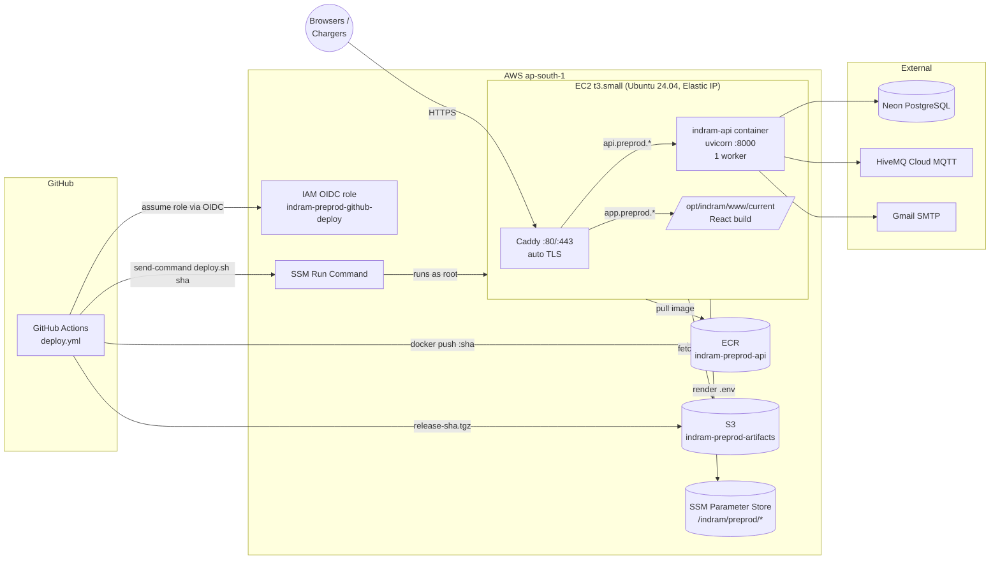

# Preprod deployment: EC2 + Terraform + GitHub Actions

This document describes how the preprod environment is provisioned and how every
merge to `main` is rolled out. Everything referenced here lives in this repository:

| Path | What it is |
|---|---|
| `infra/` | Terraform for all AWS resources (one EC2 host, ECR, S3, IAM, SSM parameters, DNS) |
| `infra/bootstrap/` | One-time Terraform state bucket |
| `deploy/` | Files that run **on the EC2 host**: `compose.yml`, `Caddyfile`, `deploy.sh`, `migrate.sh` |
| `.github/workflows/deploy.yml` | Build → push → roll out on every push to `main` |
| `.github/workflows/infra.yml` | Terraform plan on PRs, apply on `main` behind an approval |

---

## 1. Architecture



**Why one EC2 host.** The API runs the MQTT subscriber and the billing scheduler in
process, and both must run on exactly one instance (`ENABLE_MQTT`, `ENABLE_SCHEDULER`,
and a single MQTT client id). A single box with a stop-then-start rollout matches that
constraint without any ECS/ALB machinery.

**No SSH, no static keys.** Port 22 is closed. GitHub reaches the host through SSM Run
Command, and authenticates to AWS with an OIDC-federated role scoped to this repository.
Humans use SSM Session Manager (`aws ssm start-session --target <instance-id>`).

**Secrets never touch GitHub.** All runtime config lives in SSM Parameter Store under
`/indram/preprod/`. `deploy.sh` renders it into `/opt/indram/.env` on every deploy.
GitHub only holds non-secret *variables* (role ARN, instance id, bucket names, domains).

---

## 2. Deployment flow (every push to `main`)

```mermaid
sequenceDiagram
    autonumber
    actor Dev as Developer
    participant GH as GitHub Actions
    participant ECR as ECR
    participant S3 as S3 artifacts
    participant SSM as SSM Run Command
    participant EC2 as EC2 host (deploy.sh)
    participant PS as SSM Parameter Store

    Dev->>GH: git push main
    GH->>GH: test — pytest tests/
    par build-backend
        GH->>ECR: docker build + push :<sha>, :preprod-latest
    and build-release-bundle
        GH->>GH: npm ci && vite build (VITE_API_BASE=https://api.preprod…)
        GH->>S3: release-<sha>.tgz = deploy/ + migrations/ + www/
    end
    GH->>SSM: send-command "fetch bundle; deploy.sh <sha>"
    SSM->>EC2: run as root
    EC2->>PS: get-parameters-by-path /indram/preprod/ --with-decryption
    EC2->>EC2: write /opt/indram/.env
    EC2->>ECR: docker pull <sha>
    EC2->>EC2: record previous image tag
    opt RUN_MIGRATIONS=true
        EC2->>EC2: migrate.sh apply (pending NNN_*.sql)
    end
    EC2->>EC2: docker compose up -d api caddy (stop old → start new)
    EC2->>EC2: poll /health up to 90 s
    alt healthy
        EC2->>EC2: www/current → <sha> (frontend goes live)
        EC2->>EC2: prune releases older than last 3
        EC2-->>SSM: exit 0
    else unhealthy
        EC2->>EC2: docker compose up -d api with previous tag (rollback)
        EC2-->>SSM: exit 1
    end
    SSM-->>GH: command status + stdout
    GH->>GH: smoke — curl api /health and app /
```

Pipeline jobs and their gates:

| Job | Runs when | Fails the deploy if |
|---|---|---|
| `test` | always | `pytest` fails |
| `build-backend` | not a redeploy | image build/push fails |
| `build-release-bundle` | always | frontend build or upload fails |
| `deploy` | both builds green; `preprod` environment | `deploy.sh` exits non-zero (health gate) |
| `smoke` | after deploy | public API/health or app URL not reachable |

### What happens on the host, step by step

`deploy/deploy.sh <sha>` is idempotent and is the only thing SSM runs:

1. Render `/opt/indram/.env` from Parameter Store (mode 600).
2. Log in to ECR and pull `indram-preprod-api:<sha>`. Save the currently running tag to `/opt/indram/previous_tag`.
3. If the parameter `RUN_MIGRATIONS` is `true`, apply pending files from `migrations/NNN_*.sql` in order, each in its own transaction, tracked in table `schema_migrations`.
4. Copy the frontend build to `/opt/indram/www/<sha>` (not live yet).
5. `docker compose up -d` with the new image. Compose stops the old API container and starts the new one. Caddy keeps running, so TLS and the old frontend stay up during the 5 to 10 seconds the API restarts.
6. Poll `/health` inside the container for up to 90 seconds.
7. **Healthy:** flip the `www/current` symlink so the new frontend goes live together with the new API. **Unhealthy:** dump the last 100 log lines, restart the previous image, and exit 1 so the GitHub job goes red.
8. Keep the last 3 releases on disk, prune dangling images.

Directory layout on the host:

```
/etc/indram.conf                 ENV_NAME, AWS_REGION, ECR_REPO_URL, APP_DOMAIN, API_DOMAIN (from user_data)
/opt/indram/.env                 rendered secrets, rewritten on every deploy
/opt/indram/release/<sha>/       unpacked bundle: deploy/, migrations/, www/
/opt/indram/release/current  ->  live release (compose project runs from here)
/opt/indram/www/<sha>/           frontend build
/opt/indram/www/current      ->  what Caddy serves
/opt/indram/previous_tag         last known-good image tag
```

### Rollback

- **Fast:** Actions → *Deploy preprod* → *Run workflow* → set `image_tag` to a previous commit SHA. The image build is skipped; the bundle (frontend + scripts) is rebuilt from whatever ref you choose, so pick that same commit as the ref.
- **Clean:** `git revert` and push to `main`. Normal pipeline.
- **Automatic:** a failed health gate restarts the previous image on its own, as shown in the diagram.

---

## 3. One-time setup

### 3.1 Bootstrap the state bucket (local, once)

```bash
cd infra/bootstrap
terraform init && terraform apply          # creates s3://indram-terraform-state
```

### 3.2 First `terraform apply` (local, once)

The GitHub roles are created by Terraform, so the first apply has to run with your own
AWS credentials.

```bash
cd infra
cp backend.hcl.example backend.hcl         # edit if you changed the bucket name
cp terraform.tfvars.example terraform.tfvars
$EDITOR terraform.tfvars                   # domains, optional route53_zone_id
terraform init -backend-config=backend.hcl
terraform apply
terraform output github_variables
```

If the AWS account already has the `token.actions.githubusercontent.com` OIDC provider
(for example because another repo uses it), set `create_github_oidc_provider = false`.

### 3.3 Fill in the secrets

Terraform creates every `SecureString` as a `CHANGE_ME` placeholder and then ignores
its value, so secrets never land in the state file. Set each one:

```bash
P=/indram/preprod
aws ssm put-parameter --overwrite --type SecureString --name $P/DATABASE_URL        --value 'postgresql+asyncpg://…?ssl=require'
aws ssm put-parameter --overwrite --type SecureString --name $P/SECRET_KEY          --value "$(python3 -c 'import secrets;print(secrets.token_hex(32))')"
aws ssm put-parameter --overwrite --type SecureString --name $P/MQTT_HOST           --value 'xxxx.s1.eu.hivemq.cloud'
aws ssm put-parameter --overwrite --type SecureString --name $P/MQTT_USERNAME       --value '…'
aws ssm put-parameter --overwrite --type SecureString --name $P/MQTT_PASSWORD       --value '…'
aws ssm put-parameter --overwrite --type SecureString --name $P/GMAIL_USER          --value '…'
aws ssm put-parameter --overwrite --type SecureString --name $P/GMAIL_APP_PASSWORD  --value '…'
aws ssm put-parameter --overwrite --type SecureString --name $P/CMD_AUTH_TOKEN      --value '…'
aws ssm put-parameter --overwrite --type SecureString --name $P/SUPER_ADMIN_EMAIL   --value '…'
aws ssm put-parameter --overwrite --type SecureString --name $P/SUPER_ADMIN_PASSWORD --value '…'
```

Non-secret settings (`ENABLE_MQTT`, `ENABLE_SCHEDULER`, `MQTT_CLIENT_ID`, `RUN_MIGRATIONS`,
…) are in the `app_parameters` map in `infra/variables.tf`; change them there and apply.
Any key in that map or in the secret list becomes an environment variable in the container.

> **MQTT client id.** preprod and prod share the HiveMQ cluster. The app now reads
> `MQTT_CLIENT_ID` (default `evc-server-prod`); preprod is set to `evc-server-preprod`.
> Two connections with the same id kick each other off the broker (the "Code 7" issue).

### 3.4 Baseline the migration tracker (only for an existing database)

`migrations/001_*.sql` truncates tables. On a database that was already set up by hand,
mark every file as applied without running it, once:

```bash
aws ssm start-session --target <instance-id>
sudo -i
export DATABASE_URL="$(grep ^DATABASE_URL= /opt/indram/.env | cut -d= -f2-)"
/opt/indram/release/current/deploy/migrate.sh baseline
```

Then set the parameter `RUN_MIGRATIONS` to `true` so future deploys apply new files.

### 3.5 GitHub configuration

Create two environments under **Settings → Environments**:

| Environment | Purpose | Protection |
|---|---|---|
| `preprod` | the `deploy` job | optional required reviewer |
| `preprod-infra` | the Terraform `apply` job | required reviewer recommended |

Add these **variables** (not secrets) at repository or environment level, taken from
`terraform output github_variables` plus the state bucket:

```
AWS_REGION            ap-south-1
AWS_DEPLOY_ROLE_ARN   arn:aws:iam::…:role/indram-preprod-github-deploy
AWS_INFRA_ROLE_ARN    arn:aws:iam::…:role/indram-preprod-github-infra
EC2_INSTANCE_ID       i-…
ECR_REPOSITORY        indram-preprod-api
ARTIFACTS_BUCKET      indram-preprod-artifacts
APP_DOMAIN            app.preprod.indram.in
API_DOMAIN            api.preprod.indram.in
TF_STATE_BUCKET       indram-terraform-state
ROUTE53_ZONE_ID       (empty if DNS is managed elsewhere)
```

### 3.6 DNS and TLS

Point `APP_DOMAIN` and `API_DOMAIN` at `terraform output public_ip` (or set
`route53_zone_id` and let Terraform do it). Caddy obtains Let's Encrypt certificates
automatically on first request once DNS resolves; nothing else to configure.

### 3.7 First deploy

Push to `main` (or run *Deploy preprod* manually). Watch the `deploy` job log: it prints
the full `deploy.sh` output from the host.

---

## 4. Day-2 operations

| Task | How |
|---|---|
| Shell on the box | `aws ssm start-session --target <instance-id>` |
| API logs | `docker logs -f indram-api` |
| Caddy logs | `docker logs -f indram-caddy` |
| Change a non-secret setting | edit `app_parameters` in `infra/variables.tf`, open a PR (plan is commented), merge, approve apply, then redeploy so `.env` is re-rendered |
| Rotate a secret | `aws ssm put-parameter --overwrite …`, then redeploy |
| Migration status | `migrate.sh status` on the host |
| Resize the instance | change `instance_type`, apply (brief stop/start) |
| Rebuild the host from scratch | `terraform taint aws_instance.app && terraform apply`, then redeploy. The Elastic IP is kept. |

---

## 5. Changes made to the application for this

- `frontend-WebsiteTheme/src/api/client.js` reads `VITE_API_BASE` at build time; falls back to the old hostname logic.
- `app/config.py` gains `CORS_ORIGINS` and `MQTT_CLIENT_ID`; `app/main.py` and `app/mqtt_subscriber.py` read them from settings.
- `Dockerfile` has a `HEALTHCHECK`; `.dockerignore` excludes the frontend, infra and deploy folders from the build context.
- `env.example` documents every variable for local development.
- The previous ECS/S3 workflow was replaced; it synced a `./frontend/` directory that does not exist and never ran a frontend build.
